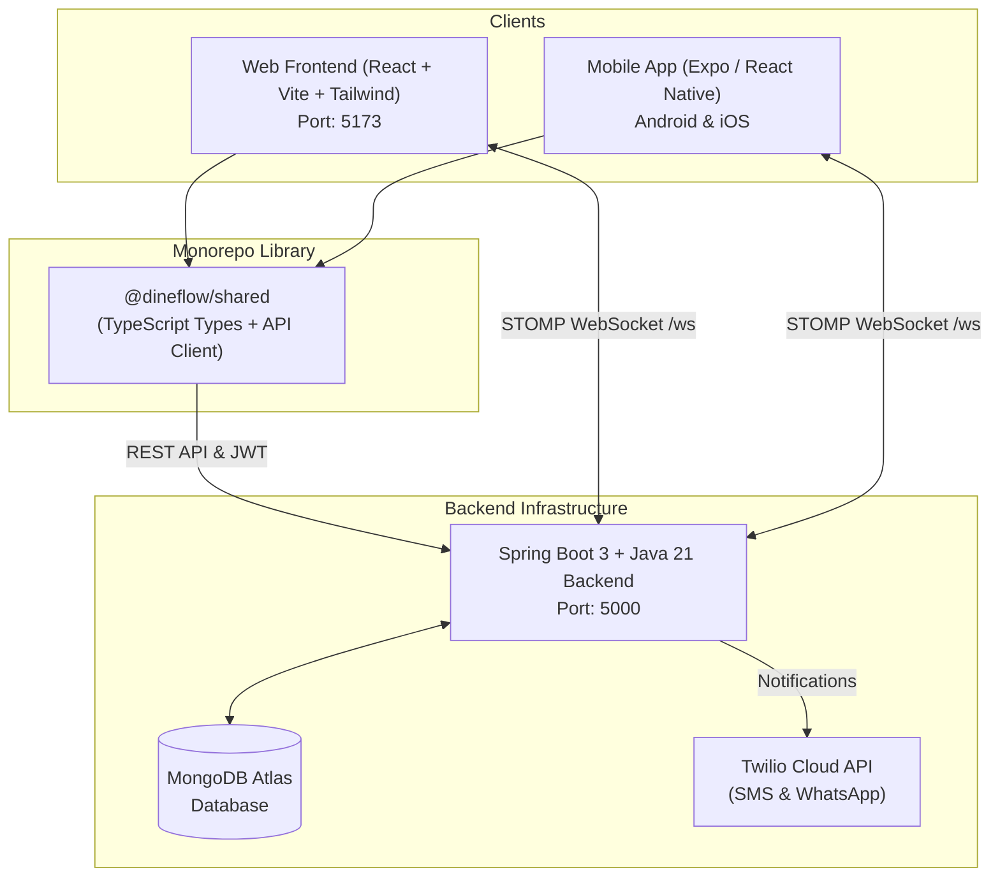

# DineFlow Pro — Modern Restaurant Floor & Waitlist Management

A full-stack, enterprise-grade restaurant table and waitlist management platform featuring real-time floor updates, SMS/WhatsApp guest messaging, and role-based operational dashboards.



---

## 🏗️ Monorepo Structure

```text
DineFlow-main/
├── backend-java/         # Spring Boot 3 + Java 21 backend (Maven)
│   ├── src/main/java/    # Clean architecture: controller, service, repository, model, security
│   ├── src/test/java/    # Unit & Integration test suites
│   ├── Dockerfile        # Multi-stage production container build
│   └── pom.xml           # Dependencies: Spring Web, Mongo, Security, STOMP, Twilio, OpenAPI
├── web/                  # React 18 + Vite web dashboard (migrated from legacy root)
│   ├── src/              # shadcn/ui components, STOMP realtime hooks, Manager/Host/Staff views
│   └── package.json      # Vite build without direct Twilio or Supabase
├── mobile/               # Expo SDK 51 React Native mobile application
│   ├── app/              # Expo Router tabs (Dashboard, Tables, Waitlist, Analytics, Settings)
│   ├── src/              # NativeWind styling, SecureStore JWT auth, STOMP realtime
│   └── eas.json          # EAS build profiles for Android (APK/AAB) & iOS (IPA)
├── shared/               # Shared TypeScript package
│   ├── src/types/        # Unified DTOs, models, and WebSocket event types
│   └── src/api/          # Universal Axios API client with interceptors
└── backend/              # Original Node.js / Express backend (preserved for backward compatibility)
```

---

## ⚡ Quick Start

### 1. Spring Boot Backend (`/backend-java`)
Requires **Java 21** and a running MongoDB instance (or Atlas URI).
```bash
cd backend-java

# Copy environment variables
cp .env.example .env

# Build and start server on port 5000
./mvnw clean spring-boot:run
```
* **Swagger OpenAPI Docs:** [http://localhost:5000/swagger-ui.html](http://localhost:5000/swagger-ui.html)
* **WebSocket Endpoint:** `http://localhost:5000/ws` (Topic: `/topic/all`)

### 2. Web Application (`/web`)
```bash
cd web

# Install dependencies & run development server on port 5173
npm install
npm run dev
```
* Open in browser: [http://localhost:5173](http://localhost:5173)

### 3. Mobile App (`/mobile`)
```bash
cd mobile

# Install dependencies & start Expo bundler
npm install
npx expo start
```
* Press `i` for iOS Simulator, `a` for Android Emulator, or scan the QR code with **Expo Go**.

---

## 🔐 Default Credentials (Auto-seeded on first launch)

| Role | Email | Password | Access Level |
|---|---|---|---|
| **Manager** | `admin@dineflow.com` | `admin123` | Full administrative access, floor plan customization, table deletion, business analytics |
| **Host** | `host@dineflow.com` | `host123` | Waitlist queue management, SMS/WhatsApp notifications, guest seating |
| **Staff / Waiter** | `staff@dineflow.com` | `staff123` | Table status switching (Free, Occupied, Cleaning, Reserved) |

---

## 🔌 API & WebSocket Contracts

### REST Endpoints
* **Authentication:** `POST /api/auth/register`, `POST /api/auth/login`, `GET /api/auth/me`, `PUT /api/auth/update-profile`, `PUT /api/auth/update-password`
* **Tables:** `GET /api/tables`, `POST /api/tables`, `GET /api/tables/{id}`, `PUT /api/tables/{id}`, `DELETE /api/tables/{id}`, `GET /api/tables/stats/overview`
* **Waitlist:** `GET /api/waitlist`, `POST /api/waitlist`, `GET /api/waitlist/{id}`, `PUT /api/waitlist/{id}`, `DELETE /api/waitlist/{id}`, `POST /api/waitlist/{id}/notify`, `POST /api/waitlist/{id}/seat`, `GET /api/waitlist/stats/overview`
* **Activities:** `GET /api/activities?limit=50`
* **Analytics (Manager):** `GET /api/analytics/overview`, `GET /api/analytics/occupancy`, `GET /api/analytics/wait-time`, `GET /api/analytics/service-duration`, `GET /api/analytics/waiter-performance`, `GET /api/analytics/revenue`

### WebSocket STOMP Events (`/topic/all`)
```json
{
  "event": "table:updated",
  "payload": { "table": { "_id": "...", "status": "occupied", "tableNumber": "4" } },
  "timestamp": "2026-11-19T14:00:00Z"
}
```
* `table:created`, `table:updated`, `table:deleted`
* `waitlist:added`, `waitlist:updated`, `waitlist:removed`
* `guest:seated`, `notification:sent`, `activity:new`

---

## 🛡️ Security & Twilio Remediation
* Twilio credentials (`TWILIO_ACCOUNT_SID`, `TWILIO_AUTH_TOKEN`) are strictly confined to server-side environment variables and are never bundled in frontend or mobile builds.
* When Twilio credentials are not configured, `TwilioService` automatically activates **Mock Mode**, logging SMS/WhatsApp payloads to the server console and simulating successful delivery with mock message IDs.

---

## 🚀 Deployment

* **Backend:** Deployable on Render / Railway via `backend-java/Dockerfile` and `render.yaml`.
* **Web Frontend:** Deployable on Vercel using `vercel.json` pointing to root `web`.
* **Mobile App:** Build standalone iOS (IPA) and Android (APK / AAB) binaries via `eas build`.
* **CI/CD:** Automated GitHub Actions workflows in `.github/workflows/` for testing backend, web, and mobile builds on every pull request.
